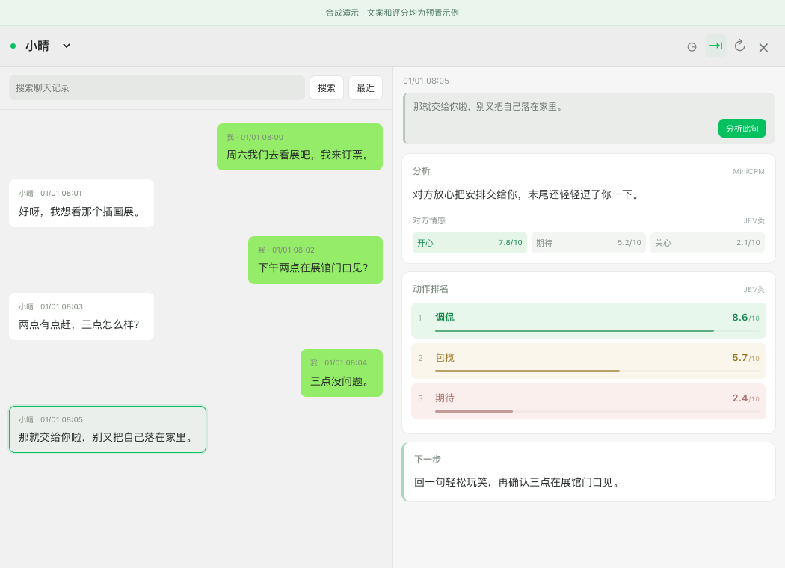

# JEV 心动导师 · Heart Mentor

给聊天装上 Galgame 选项框，让 JEV 当你的情感参谋。点击对方的一句话，查看**分析、动作排名、下一步**。

JEV 心动导师是一个提供情感支持与互动建议的本地对话决策卡原型（代码包名 ChatLens）。它把语言表达和选项评分分开：MiniCPM 负责写分析与具体做法，Typical 决策模型负责在完整动作库中打分。卡片采用接近微信的简洁风格，支持自由拖动和贴靠微信窗口。



*截图与演示使用虚构人物、预置文案和评分。*

## 30 秒体验界面

无需微信账号、模型权重或 macOS 权限。安装完成后即可打开合成演示：

```sh
git clone https://github.com/Leipengpeng/JEV-Heart-Mentor.git
cd JEV-Heart-Mentor
python -m venv .venv
source .venv/bin/activate
pip install -e .
chatlens demo --open
```

Windows 使用 `.venv\Scripts\activate` 激活环境。点击左侧对方的消息，或切换联系人，即可查看不同位置的卡片；`Ctrl+C` 停止演示服务。

演示结果是固定示例，**不会运行模型，也不读取真实聊天**。首次安装耗时取决于 Python 环境和网络。

## 它做什么

- 以点击的对方消息为时间节点，读取此前双方的对话；最终只分析对方，站在我方视角建议互动方式。
- 默认从 300 条来源消息中检索，最多支持 1000 条。优先保留最近 12 条，再补入 JEV 式检索选中的旧原文，按 token 预算装入 MiniCPM。
- 全部 31 个两字动作参与评分，例如夸奖、安慰、邀约、直球、沉默。MiniCPM 不预筛动作，也不修改评分或顺序。
- 从固定 9 种情感中展示前三项；动作排名同样展示前三项，采用 10 分制。
- 新联系人先显示“是否分析”，用户选择分析后才读取该联系人的历史并启动模型。生成回复保持为建议，程序不会自动发送微信消息。

这里的“JEV”描述决策分工。当前实际使用 **Typical-small 的决策权重与 Qwen3-1.7B-Base**，属于类似方案，**不是官方 JEV 实现或权重**。

动作和情感的分数表示候选之间的排序，不能解释为准确率或心理状态概率。接近分数的非线性对比变换只影响界面显示，底层评分、顺序与模型输入保持原值。

## 运行本地模型

当前完整路径面向 **Apple Silicon、macOS 14+**，需要 Python 3.11/3.12 和 Xcode Command Line Tools。先完成上面的虚拟环境安装，再运行：

```sh
pip install -e '.[models]'
chatlens download-models
python scripts/build_macos.py
chatlens import-json examples/conversation.json
chatlens launch --main
```

先用仓库内的合成 JSON 验证模型与窗口。打开后选择联系人并点击“分析”，模型首次加载会比后续分析慢。

模型下载采用固定提交版本，并校验上游 LFS 文件的 SHA-256；本仓库不包含权重。推理阶段从本地读取权重，没有云模型回退。

| 用途 | 公开模型仓库 | 固定 revision |
| --- | --- | --- |
| 决策权重 | `OzLabs/typical-small` | `0ff732eafcc22d879446628433c920466e913283` |
| 决策骨干 | `Qwen/Qwen3-1.7B-Base` | `ea980cb0a6c2ae4b936e82123acc929f1cec04c1` |
| 语言表达 | `openbmb/MiniCPM5-2B-MLX` | `8a9ad7539ac86281d0ac2b017ba04a5de53fe9a3` |

权重和依赖各自受其许可证约束，参见 [第三方说明](THIRD_PARTY_NOTICES.md)。完整安装、JSON 格式和可选微信接入见 [设置指南](docs/setup.md)。

## 微信接入的边界

原生界面是独立的伴随窗口，不向官方微信安装插件或注入卡片。点击定位优先读取 macOS 辅助功能信息，必要时回退到可见微信窗口的本机 OCR；聊天上下文主要来自已导入的本地历史。

原生数据库接入是可选适配器：需要自行配置兼容的外部 `wxexport` 模块、已有有效密钥和数据库位置。**克隆项目不会自动解密微信，也不会自动完成登录或系统授权。**未配置适配器时，可使用标准 JSON 导入。

| 平台 | 支持范围 |
| --- | --- |
| Apple Silicon / macOS 14+ | 合成演示、JSON 导入、本地 MLX 模型、原生伴随窗口；微信数据接入需单独配置 |
| Windows / Linux | 合成演示、JSON 导入与纯 Python 规则模块；当前不支持完整 MLX / 原生窗口流程 |
| Intel Mac | 可体验演示与 JSON；完整模型和原生构建尚不支持 |

## 项目结构

```text
src/chatlens/        Python 包、模型管线、本地 API
  knowledge/        原创互动动作库与 prompt
  web/              决策卡 HTML / CSS / JavaScript
macos/              原生伴随窗口与点击观察器
scripts/            原生构建与发布检查
examples/           虚构的 JSON 对话样例
tests/              合成数据的 Python / JavaScript 测试
docs/               架构、设置、排障与演示图片
.github/            GitHub 工作流与协作模板
```

私密聊天、密钥、数据库、会话凭据和调试输出写入仓库之外的 `DATA_DIR`；模型也单独存放。默认关闭包含聊天内容的调试记录。路径和可选配置见 [设置指南](docs/setup.md#数据与配置)。

## 开发与测试

```sh
pip install -e '.[dev,test]'
python -m unittest discover -s tests
node --test tests/*.js
```

PyTorch 用于评分协议测试；未安装 MLX 或本地 tokenizer 时，相关可选检查会跳过。上述回归测试使用合成数据，不需要微信登录或下载模型。它们覆盖规则、上下文预算、引用校验、选择竞争和输出错误修正；不能替代真实机器上的模型质量与系统权限测试。

进一步阅读：[架构](docs/architecture.md) · [排障](docs/troubleshooting.md) · [贡献指南](CONTRIBUTING.md) · [隐私说明](docs/privacy.md)

项目处于原型阶段，微信版本与辅助功能行为变化可能影响点击定位。代码采用 [MIT 许可证](LICENSE)。
