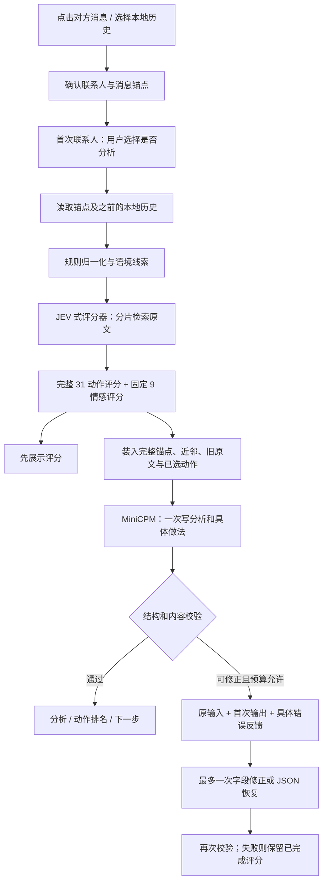

# 架构与数据流

ChatLens 把决策评分与自然语言表达分开。这里的 JEV 式评分器实际是 Typical-small + Qwen3-1.7B-Base；MiniCPM5-2B-MLX 负责把选中的互动方式写成短分析和具体做法。

## 一次点击发生什么

“单次 MiniCPM”指常规业务生成一次；不是一次 Transformer 前向计算。模型的有界思考与答案生成可能分别预填充。只有出现可修正的输出错误时，才允许额外一次错误反馈调用，不再重新运行 JEV 检索或评分。

## 数据与定位

`HistoryStore` 把消息保存到本地 SQLite，按联系人 ID、时间、顺序和稳定消息 ID 定位。显示姓名可以重复，不能作为唯一身份。

消息输入包括 `self`、`other`、`unknown` 三种角色。双方历史都供模型理解语境，分析对象必须是选中的 `other` 消息；点击自己的消息或身份不明的消息不会悄悄改为分析另一句。

macOS 点击观察器优先读取辅助功能树，获取会话标题、消息文字和点击位置；辅助功能不足时可以使用微信可见窗口的本机 OCR。它负责定位，历史存储负责提供上下文。规则结合原文、邻近消息和顺序匹配消息锚点；有歧义时显示候选，让用户确认。

上下文以锚点为截止线，不使用之后的消息。默认读取最多 300 条可用来源消息，接口最大 1000 条；这不等于把全部来源原文一次塞进两个模型。

## 两个模型分别接收什么

| 阶段 | 输入 | 输出 |
| --- | --- | --- |
| JEV 式原文检索 | 当前对方消息、近邻、分片后的此前双方原文与检索问题 | 被选中的原文索引和片段 |
| 动作评分 | 当前语境、检索原文、完整 31 个动作的含义 | 候选分数、排名和决策状态 |
| 情感评分 | 当前语境、检索原文、固定 9 种情感 | 情感分数及排名 |
| MiniCPM 表达 | 完整当前消息、优先保留的近 12 条、预算内的旧原文、JEV 前三动作及情感顺序 | 简短分析、具体动作说明、回复草稿、可校验引用 |

固定情感为：平静、开心、期待、关心、疑惑、焦虑、失望、生气、难过。界面只显示前三项。

MiniCPM 不预筛动作、不重新决定赢家、不修改 JEV 分数。动作标题保持两字；最终界面仅展示分析、动作排名、下一步，下一步取最高排名动作对应的具体说明。

## 上下文预算

- **JEV 状态上限 1024 tokens**；候选后缀同样按上限核对。包装文字也计入预算。长历史通过多个有界分片参与检索。
- **MiniCPM 完整输入上限 3000 tokens**。首次输入预留 128 tokens 思考预算及包装余量，初始装箱上限 2840 tokens。
- 完整锚点优先，其次是近 12 条连续消息，再加入被检索选中的旧原文及邻句。预算不足时减少可选引文，不把缺失文本伪装成完整历史。
- 单次答案最多 768 tokens，当前常规表达使用贪心采样。短句收尾和重复动作定义可先做有限规则处理。
- 修正调用必须包含原始输入、第一次输出、错误字段、错误类型和修正要求；超过预算时跳过，不通过截掉原输入来勉强调用。

当前主路径不先让 LLM 分片总结全部历史，避免生成摘要引入新事实与额外延迟。检索覆盖范围和实际送入 MiniCPM 的引用集合是两个不同指标。

## 稳定性与失败处理

推理服务只有一个实际工作槽。切换联系人可以清空旧卡片，但不会让仍在计算的旧任务释放工作槽；新请求会等待或收到忙碌状态，避免积压模型任务。

前端给选择、联系人切换和历史列表请求分别维护身份与顺序。旧响应不能覆盖新联系人、新句子或新查询。重新分析时保持已有卡片，直到替换结果可用。MiniCPM 文案失败时，已完成的动作和情感评分可以继续展示。

首次输出结构有效时，修正只允许改明确失败的文本字段；JSON 不完整时进入恢复模式。动作 ID、顺序、分数和引用边界仍需校验。最多修正一轮，不能无限重试。

## 分数的含义

原始分数用于当前候选集合的比较，不是情感概率、准确率或成功率。增加、删除或改写候选会改变比较任务。

界面将分数展示为 10 分制，并对某些接近的前三项做非线性对比。这只改变显示值与条形长度；原始分数、赢家、排序和传给 MiniCPM 的信息不变。相同分数保持相同，不凭空制造差距。

## 计算量与耗时

规则扫描与装箱随来源文本增长；JEV 检索随分片数增长。动作与情感集合固定为 31 和 9，MiniCPM 输入受 3000 tokens 限制，因此不会让单次表达的输入随全部历史无限增长。

Transformer 的预填充仍与输入长度有关，注意力计算通常包含二次项；不能把“检索分片数近似线性”理解为所有推理都是线性复杂度。实际耗时还受芯片、可用内存、模型加载、缓存和结构化生成约束影响。项目没有用真实私聊耗时作为公开性能承诺。

## 私密状态

本地服务只监听 `127.0.0.1`，使用会话 token 验证请求。运行状态、历史数据库、授权选择和必要缓存进入 `DATA_DIR`，不写入源码包。包含原文的调试记录默认关闭；开启后也必须留在本地。

合成演示有独立服务，既不加载模型，也不访问真实历史。它展示预置结果，不能用于衡量模型判断质量。
